# Codebase review, gap analysis, and repair design

Date: 2026-10-12. Reviewed worktree base: `48fe23be91f07d9e10de734d1bcdc15e42ced576`.
Status: review and proposed repair design; implementation has not started.
Plan: `../plans/2026-10-12-codebase-gap-remediation.md`.

## Intent and scope

The requested outcome is to study the repository using the CodeGraph MCP server, perform a code review and gap analysis using `superpowers:brainstorming`, list the discovered gaps in a table, and save an implementation plan before fixes. Success means each finding has current source evidence, a proposed repair, an owning task, and a check that can demonstrate the repair.

The working assumption is that this remains the documented self-hosted GenUI demo: React/OpenUI, Express, OpenRouter or keyless canned output, inline diagrams and interactive diagram artifacts. Authentication, persistent threads, artifact editing/versioning, billing, and production deployment infrastructure are excluded by the existing Stage 2 design. Their absence is not classified as a defect. Operational bounds are proposed even for the demo because a single long session can exhaust memory or leave child processes running.

The requested brainstorming skill informed context discovery, alternatives, architecture, failure modes, and proposed design. The user explicitly requested this saved plan; this document and the plan are reviewable proposals, not approval to implement them. No product code or dependencies were changed, no commits were made, and no paid model requests or test suites were run for this review.

## Exploration evidence and coverage

CodeGraph MCP was used first for architecture and each indexed area. Queries included `architecture App AgentInterface chat-library server scripts diagrams`, `server/chat.mjs`, `server/diagram-tool.mjs`, `src/llm.ts`, `src/artifacts/diagram-artifact.tsx`, `flow.tsx sequence.tsx explainer.tsx flow-layout.ts sequence-layout.ts`, `layoutFlow wrapLabel schemas.ts dedupe.ts`, and every application check/test/smoke script by file name. The MCP responses supplied current numbered source, callers, and dependency information. Where a response elided a route callback or renderer body, the missing section was read directly.

The MCP returned **no indexed match** for `server/vendor/diagramify/bin/diagramify.mjs` and the shared validator/utilities. `src/index.css` and the symbol-free client bootstrap were also not returned. These were inspected directly after the MCP attempts. The index was not modified. Thus this is a repository-wide architecture and static code review with focused inspection of production paths; it is not a claim that CodeGraph indexes every vendored file or that every line of its generated data has been manually audited.

| Area | Studied source and relationships | Coverage and limits |
|---|---|---|
| Client bootstrap and transport | `src/main.tsx`, `App.tsx`, `llm.ts`, `index.css`, artifact renderer | Mount → fetch adapter → tool events → preview → iframe; stream lifecycle and artifact parsing inspected |
| Inline library | `chat-library.ts`, all seven files under `src/library/diagrams/` | Component signatures, schemas, dedupe, Dagre flow layout, sequence geometry, SVG and explainer rendering |
| Server | All three top-level server modules | Startup/spec prompt, input handling, canned routing, live tool loop, error path, CLI wrapper, artifact routes |
| Generated contract | `generated/chat-library.spec.json`, `scripts/gen-spec.ts` | JSON inventory: root Card, 92 components, 8 examples; generator and freshness gate inspected; freshness was not executed |
| Application scripts | All 14 files under `scripts/` | Schema gates, layout/render contracts, error subprocess harness, tool wire tests, artifact tests, live smoke and diagnostic render check |
| Project fixtures | All 7 `server/examples/diagrams/*.json` | JSON structures and type inventory inspected; no new claim of showcase validation passing |
| Vendored CLI and renderers | Four CLI files, six renderers, architecture grid, shared utilities, geometry, validators, output guards, evidence, brands, diagnostics, text/i18n/legend helpers, delta renderer, two vendor scripts | Module/function and import inventory across all executable files; deep inspection of validate/deliver, nested subprocesses, schema boundaries, escaping, viewer export and TOC sinks |
| Vendored data/viewer | Seven schemas, 16 examples, brand catalog/generated marks, compiled validators, `assets/template.html` | Schema requirements and enums inspected, examples inventoried, viewer features and sensitive sinks surveyed; generated validators/marks treated as derived assets, not line-by-line reviewed |
| Configuration and documentation | Root/package vendor manifests, lockfile presence, Vite/TS config, index HTML, `.env.example`, ignore rules, AGENTS, README/RUNBOOK and existing plans/spec | Demo architecture contract and stated exclusions used as baseline; existing unrelated user edits preserved |

The vendored viewer includes presets, themes, export, motion controls, semantic navigation, route/reachability exploration, guided stories, evidence links, presentation, and explainer widgets. Optional preview, compare, browser opener, brand capture, and visual-check commands are outside the app's normal validate/deliver path; they were surveyed for their responsibilities and imports, not certified through execution.

## Architecture understood

```mermaid
flowchart LR
  UI[AgentInterface] --> Adapter[fetchLLM and chatAdapter]
  Adapter --> Chat[POST /api/chat]
  Library[appChatLibrary] --> UI
  Library --> Generator[gen-spec.ts]
  Generator --> Contract[generated library contract]
  Contract --> Chat
  Chat --> Canned[Canned recipes or fixture]
  Chat --> Provider[OpenRouter stream]
  Provider --> Loop[Bounded tool loop]
  Canned --> Tool[executeDiagramTool]
  Loop --> Tool
  Tool --> CLI[diagramify validate and deliver]
  CLI --> Store[In-memory HTML registry]
  Store --> Endpoint[GET /api/artifacts/:id]
  Endpoint --> Frame[Sandboxed artifact iframe]
  Adapter --> UI
```

Strengths: the client library drives the generated server contract; inline layout is separated from React rendering; duplicate/dangling references are surfaced; the tool uses fixed argument arrays rather than a shell; artifact lookup reads a registry rather than arbitrary paths; vendor templates escape text during initial rendering; normal client disconnects abort upstream calls; MIT attribution is retained.

## Discovered gaps

P1 = a correctness or isolation defect in a supported flow. P2 = resilience, validation, geometry, or verification gap. P3 = documentation debt. Findings are based on current static source. Browser effects, descendant cleanup under a hang, and environment-specific behavior still require the acceptance checks in the plan; no exploit or runtime failure is claimed to have been reproduced.

| ID | Priority | Gap and concrete trigger | Evidence | Proposed repair | Task |
|---|---|---|---|---|---|
| G01 | P1 | Architecture authoring guidance advertises `tier`, which the schema rejects, and omits `pos` or grid `layout` + `row`. A model following the prose creates invalid specs. | `server/diagram-tool.mjs:85`; `architecture.schema.json` component properties; `render-architecture.mjs:337`; `grid.mjs:22` | Teach the actual placement contract and check prose examples against all six schemas and CLI paths. | T1 |
| G02 | P1 | The live loop appends all assistant tool calls but answers only one. A batch of two leaves an unresolved call in provider history; an unknown function name falls back to diagram execution. | `server/chat.mjs:229` and `:238`; `accumulateToolCalls` preserves multiple calls | Dispatch every call with one matching result, reject unknown names, and disable parallel tool calls as an optimization only. | T3 |
| G03 | P1 | A successful third diagram attempt consumes the entire three-round budget; the final tools-disabled assistant response never runs. | `server/chat.mjs:176`, `:256` | Count render attempts separately and reserve a bounded final response after success. | T3 |
| G04 | P1 | Adapter termination is incomplete: role-only/tool-call starts remain open; `[DONE]`, EOF, length/content-filter endings and server error chunks do not close text; tool IDs persist across rounds and can be ended again. Reader cleanup is absent. | `src/llm.ts:23`, `:41`, `:100`, `:117`; server catch ends with DONE without stop | Parse SSE frames, track per-round tools and text lifecycle, terminate once, surface truncation/errors and cancel/release the reader in `finally`. | T2 |
| G05 | P1 | Canned interactive path always says it created a diagram even when the real tool returns `ok:false`. | `server/chat.mjs:124` and `:138` | Branch the closing response on the actual tool result and show failure diagnostics. | T3 |
| G06 | P1 | A completed failed artifact result falls through to its partial title, displaying an Open chip and endless Building panel. Malformed truthy success fields are accepted without runtime type checks. | `src/artifacts/diagram-artifact.tsx:25`, `:44`, `:96` | Explicit building/ready/failed states, guarded result parsing, and a missing/expired-artifact state on reopen. | T4 |
| G07 | P1 | Advertised viewer exports use an anchor download, but the host iframe grants only `allow-scripts`; download permission is absent. | `diagram-artifact.tsx:107`; vendor `template.html:6325` | Add only `allow-downloads`, preserve opaque origin, and exercise export inside the actual artifact panel. | T4 |
| G08 | P1 | Explainer section title/number text is escaped into attributes, decoded by DOM reads, then interpolated into `li.innerHTML`. Markup-like section titles become HTML in the TOC. | Vendor `template.html:14995` and `:15007`; explainer renderer `:462`; section titles accept arbitrary strings | Construct TOC nodes with DOM APIs and `textContent`; test hostile-looking titles in a browser. | T5 |
| G09 | P2 | Isolation exists only on the embedding iframe. Opening the artifact URL directly loads its scripted document on the application's origin without a response sandbox policy. | `server/diagram-tool.mjs:303` sends only content type, nosniff and no-store | Apply a response CSP sandbox allowing scripts/downloads, and restrictive content policy tested with the viewer's blob/image exports. | T5 |
| G10 | P2 | Request validation checks only a nonempty array. Null messages, invalid roles/content, caller-supplied system instructions and orphan tool messages pass to the provider. JSON parser errors use default Express handling. | `server/chat.mjs:78`, `:162`; JSON middleware `:59` | Validate bounded message history before SSE headers, keep system instructions server-owned, and return consistent JSON 400/413 errors. | T6 |
| G11 | P2 | Live routing forces tool calls for ordinary sequence/workflow/etc. diagram prompts and prompt rules demand the tool for every diagram family, overriding the documented quick inline option. Canned routing differs. | `server/chat.mjs:172`; `diagram-tool.mjs:64`; Stage 2 hybrid contract | Define a shared routing policy: explicit inline wins; explicit interactive selects tools; ordinary sketches allow inline. | T1 |
| G12 | P1 | Abort/timeout kills only the outer CLI. That CLI starts renderer/checker children with synchronous spawning, so descendants can survive their parent and continue rendering. | `server/diagram-tool.mjs:345`, `:355`, `:359`; vendor CLI `runNode` `:49` | Terminate the complete process tree, settle once, and verify descendant exit before cleanup. | T7 |
| G13 | P2 | Tool's advertised never-throws contract is broken by `rmSync` in `finally`; cleanup failure overrides a successful result or another diagnostic. | `server/diagram-tool.mjs:246`, `:287` | Catch cleanup failures, preserve the tool result, and log retryable cleanup diagnostics separately. | T7 |
| G14 | P2 | Retained HTML, simultaneous renders, stdout/stderr and model/tool streams have no application bounds. The writer ignores backpressure; no app request deadline is configured. A long session or slow reader can grow memory/work indefinitely. | registry `Map` `diagram-tool.mjs:244`; buffers `:350`; server writer `chat.mjs:98`; provider create `:190` | Bound artifact count/bytes/age, render admission, subprocess output, request duration and SSE queues; make saturation visible. | T8/T9 |
| G15 | P2 | Inline sequence self-loop labels are exempt from truncation and placed at `x+44`, but viewBox width remains last lane +90. A loop on the last lane with a long label is clipped. | `sequence-layout.ts:77`, `:103`; `sequence.tsx:119` | Include loop path/label extents in layout and preserve full label details. | T10 |
| G16 | P2 | Inline diagram maxima and the no-flow-self-edge rule exist only in prompt text. Arrays/schemas are unbounded and `layoutFlow` accepts self-edges. | `chat-library.ts:31`, `:32`, `:101`; `flow.tsx:170`; `sequence.tsx:180`; `explainer.tsx:93`; `flow-layout.ts:113` | Add bounded render normalization and schema constraints compatible with partial streaming; report omissions. | T10 |
| G17 | P2 | Inline diagrams expose only generic image names. Truncated participant/node/message labels have no full-text alternative, and sequence arrows do not retain endpoint IDs in layout output. | SVG labels `flow.tsx:58`, `sequence.tsx:51`; label slices `sequence.tsx:103`; `sequence-layout.ts:19` | Add meaningful textual graph descriptions, full labels, relationships and ordered explainer semantics. | T10 |
| G18 | P2 | Diagram smoke computes a fetched hash but compares it to no expected digest. It can count any tool ID or final diagramId as tool-call success, and does not require `ok:true` or DONE. | `scripts/live-diagram-smoke.mjs:56`, `:86`, `:124`; tool result lacks hash | Return a small digest/byte receipt and require matched create_diagram events, success, DONE, retrieval bytes/hash and headers. | T11 |
| G19 | P2 | Error harness inherits local provider key/base URL from its parent and uses a fixed port without ensuring the healthy process is its child. Canned/live mode tests can observe the wrong configuration or server. | `scripts/test-error-visibility.mjs:8`, `:12`, `:24` | Clear provider configuration explicitly, allocate an isolated port and tie readiness/exit to the spawned child. | T12 |
| G20 | P2 | Several substantive checks have no npm entrypoint or aggregate gate, and there is no committed CI workflow to enforce the library/server prompt invariant and Stage 2 regressions. Existing wire test covers one call only. | `package.json` scripts; scripts inventory and `test-tool-wire.mjs:38`; workflow inventory | Add deterministic offline test entrypoints, aggregate verify command and CI, including multi-round and failure coverage. | T12 |
| G21 | P2 | Vendor package identifies a dev version but records no pinned source revision/checksum manifest. Its validator/brand generation and test scripts refer to files absent from this vendored subset, preventing documented regeneration. | `server/vendor/diagramify/package.json`; vendor file inventory | Record verifiable provenance and subset boundary, import required generation inputs/scripts, and check compiled assets against schemas. | T13 |
| G22 | P3 | Runbook still names the stock adapter and base library, claims a model default although startup requires a model, and excludes already implemented features. README quickstart omits the required `.env` copy for npm dev. | `RUNBOOK.md` phase intro, menu table, adapter/model paragraphs and next phases; README quickstart; package dev script | Rewrite operation docs to match current Stage 2 behavior and document the new bounds/error states. | T14 |
| G23 | P2 | App imports `@openuidev/react-headless` directly but does not declare it; checks importing TS/TSX are labeled as plain node commands despite Node 20 support. Root manifest has no Node floor. | `src/llm.ts:18`; artifact import `:1`; `package.json`; `test-tool-wire.mjs:2`, `:5`; artifact test imports TSX | Declare compatible direct dependency and engines, use local tsx for TS/TSX scripts, and verify clean install on supported Node versions. | T12 |
| G24 | P2 | Two gates can report success without proving their description: check-render ignores parse errors if any SVG exists, and example coverage accepts names from component groups even with no diagram example. | `scripts/check-render.tsx:47`, `:58`; `validate-examples.mjs:34` | Require zero parse errors plus expected component output; measure example coverage from parsed examples rather than groups. | T11 |

G07 follows the [HTML Standard sandbox download rules](https://html.spec.whatwg.org/multipage/iframe-embed-object.html#attr-iframe-sandbox). G09 is a missing isolation boundary, not a claim that all generated diagram HTML is unsafe. G08 identifies one concrete unsafe re-insertion path in otherwise escaped output.

## Brainstormed repair approaches

| Approach | Benefit | Cost/risk | Decision |
|---|---|---|---|
| Repair existing boundaries in stages | Keeps OpenUI library contract and CLI integration; each fix has focused evidence and a regression gate | Needs explicit transport/state and resource policies | Recommended |
| Rewrite server and adapter around a new transport | Could simplify event semantics | Broad compatibility migration and changes unrelated to findings | Defer |
| Expand into an authenticated persistent service | Supports long-term shared use | New product scope, storage and deployment decisions | Outside this review |

The recommended design keeps Express, the generated library, OpenAI-shaped SSE and diagramify CLI. Small modules isolate policy, orchestration, request validation, process execution and resource accounting where each responsibility needs independently controllable checks. Existing in-memory behavior remains, with bounded retention and visible expiry.

## Proposed repair requirements

These defaults are planning choices, not existing behavior or approved product requirements. Executors must review this document and the plan before implementation.

1. Keep Node 20+, strict TypeScript for client code, ESM, two-space indentation, double quotes and semicolons in app-owned code. Retain the vendored MIT LICENSE; record any intentional vendor patch.
2. Keep browser and server library contract identical. Regenerate with `npm run gen:spec` after every `src/library/` change; never edit generated JSON by hand.
3. Serve all six artifact types and all three inline families. Explicit inline requests must use inline components; explicit interactive/explorable/artifact/diagramify diagram requests must use tools. Preserve ordinary non-diagram chat.
4. Execute at most three diagram attempts per request: initial plus two repair retries for a single diagram. Batches share this execution budget; excess calls receive a budget error result. After success, allow one separate tools-disabled final model response. Answer every emitted tool call exactly once, including unknown names. Process calls sequentially; disable provider parallel calls when supported.
5. Adapter text and tool starts must each have one end; DONE/EOF/abort/error/truncation must terminate owned state and release transport resources. SSE frames may cross any byte boundary and use CRLF. Do not swallow an error as a successful response.
6. Artifact states must be building, ready, failed or missing. Failed results must not be reinterpreted as partial success. Results require typed `ok`, UUID id, nonempty title and allowed type; receipt includes SHA-256 and UTF-8 byte count.
7. Sandbox permits scripts and downloads only. Add a response sandbox policy for direct navigation; do not grant same-origin or top-navigation. Viewer-generated text must remain text at every DOM sink. Browser acceptance must cover actual host-panel export and isolation.
8. Request body stays at 1 MiB. Accept at most 100 history messages with roles user/assistant/tool, strings or supported text-part content, properly shaped assistant tool calls and matching tool results. Reject caller system/developer roles. Validate before streaming headers. Return JSON errors for bad/oversize bodies.
9. Proposed resource defaults: artifact retention 100 entries, 64 MiB total UTF-8 HTML, 60-minute TTL; per artifact 2 MiB; at most 2 active diagram jobs; no render queue (saturation returns a structured busy error). Cap CLI stdout and stderr at 1 MiB each. Keep 15-second CLI command deadline; use a 120-second whole chat deadline, 2 MiB accumulated model text/tool argument bytes, and a 256 KiB pending SSE write budget. All limits produce visible errors, not silent success. These limits are application policy, independent of provider defaults.
10. Inline limits: 12 flow nodes, 24 flow edges, 6 sequence participants, 12 messages, 12 explainer steps. Flow self-edges are dropped and reported. Normalize streaming arrays before layout; display omissions, retain full labels for accessible descriptions, and contain loop geometry.
11. Verification must be offline by default and hermetic. Live smoke requires deliberate endpoint/key configuration and proves digest agreement, tool correlation and completion. Clean installation and gates must work on Node 20 and Node 24. Tests on browsers are separate from Node string-render checks.
12. Vendor regeneration must have traceable inputs/provenance and an explicit subset manifest. Documentation must describe the actual custom adapter, library, hybrid routing, configuration and artifact lifetime.

## Completion criteria for later implementation

All G01–G24 must have their owning task accepted. The plan defines focused regression commands, a complete offline gate, browser acceptance and opt-in live checks. Static review provides evidence for findings; it does not establish that current tests pass, that a browser exploit has run, or that the proposed fixes work. Runtime/provider-specific conclusions remain unverified until those checks run.
